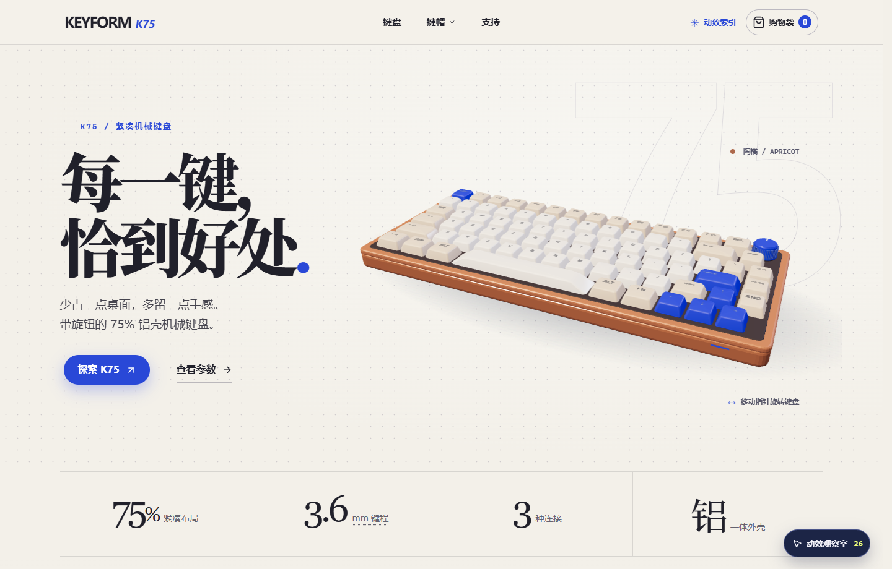
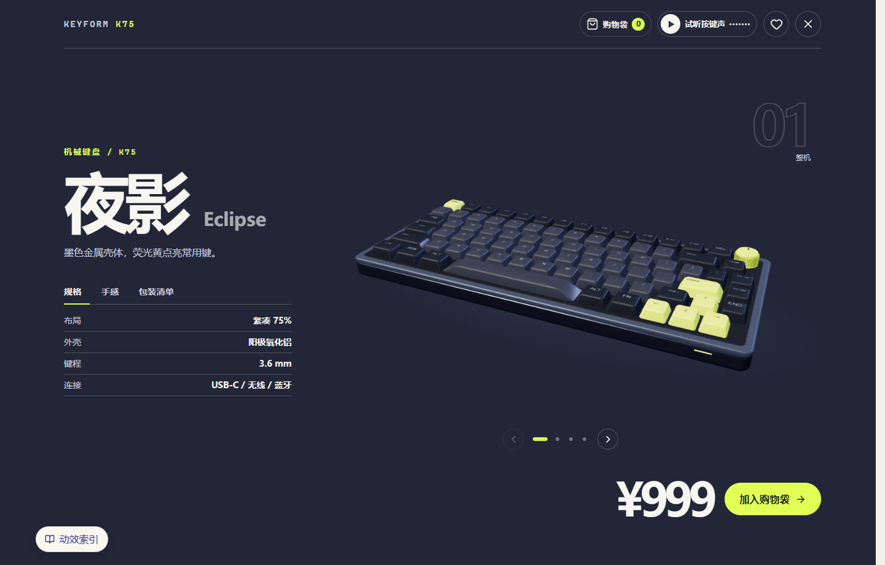

# 动效观察室 · KEYFORM K75

[在线体验](https://yangwei251003.github.io/motion-observatory/)

在一间原创虚拟机械键盘展厅中体验 26 种交互动效。首页的产品是真正可旋转的三维模型；详情支持四角度轮播、规格标签、按键试听、收藏、加购物袋、增减配件及结算演示。打开「动效索引」即可按名称或序号跳到实际操作位置，查看对应原视频时间，复制可复用的交互描述。





## 本机运行

使用 Node.js 24。

```sh
npm ci
npm run dev
```

生产版本使用 `npm run build` 后运行 `npm run preview -- --port 4239`。测试从已运行的生产预览访问，默认地址为 http://127.0.0.1:4239/，也可通过 `OBSERVATORY_URL` 指定线上地址。 `OBSERVATORY_ENGINE` 支持 `chrome`、`edge` 和 `webkit`。

```sh
npm test
```

原创键盘模型见 `src/keyboard.ts`。四种实拍式视角由同一模型计算，`npm run render` 通过本机 Chrome 重新生成 12 张透明 WebP 商品图。浏览器无法使用 WebGL 时，首页使用静态产品图的透视层接收指针，无需额外下载。全部商品颜色、参数、名称、价格和订单为示意数据。试听采用本机合成按键声；购物袋和表单仅保存在当前页面，订阅不发送网络请求。

[逐项原片依据与实现](docs/effects.md) · [浏览器验证记录](docs/validation.md)

源代码许可见 [MIT License](LICENSE)，依赖见 [第三方许可](THIRD-PARTY-NOTICES.md)。
